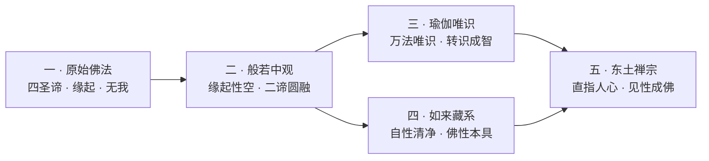

# 00 · 佛学修证全景图

> 一切佛法，归根结底只回答一个问题：**苦从何来，如何彻底止息？**  
> 禅宗并非凭空而起，而是佛陀一代时教在东土结出的最凝练之果。

---

## 一、总脉络：五重转进

这五重并非互相否定，而是**同一轮明月在不同角度下的显影**，也是破除人类认知执着的五把手术刀：

| 阶次 | 核心命题 | 所破之执 | 代表典籍 | 终极指向 |
| :--- | :--- | :--- | :--- | :--- |
| **原始佛法** | 诸行无常、诸法无我、涅槃寂静 | 破「常、乐、我、净」四颠倒 | 《阿含经》 | 止息贪嗔痴，出离轮回苦 |
| **般若中观** | 缘起故性空，性空故缘起 | 破「实有自性」与「顽空断灭」二边 | 《心经》《金刚经》《中论》 | 照见五蕴皆空，无所住而生心 |
| **瑜伽唯识** | 三界唯心，万法唯识 | 破「心外实境」的二元对立 | 《解深密经》《成唯识论》 | 转染成净，转八识成四智 |
| **如来藏系** | 一切众生皆具如来智慧德相 | 破「佛在心外、自轻退屈」之执 | 《楞严经》《大乘起信论》 | 识自本心，知真如本来圆满 |
| **东土禅宗** | 教外别传，不立文字，直指人心 | 破「名相知见、渐次戏论」之执 | 《六祖坛经》《信心铭》 | 当下顿悟，平常心是道 |

---

## 二、核心骨血：三法印与空性

### 1. 缘起（Pratītyasamutpāda）
> **此有故彼有，此生故彼生；此无故彼无，此灭故彼灭。**

宇宙中没有任何事物是孤立、恒常、独立自存的（无自性）。一切现象都是无数因缘聚合的暂时显现。

### 2. 性空（Śūnyatā）
「空」不是什么都没有的虚无（断灭空），而是**没有固定不变的实体（无自性）**。
- 正因为「空」，事物才得以变化、连接、生起（真空妙有）。
- 执着于「有」，则生贪爱与恐惧；执着于「空」，则堕冷漠与虚无。
- 龙树菩萨一言以蔽之：**「以有空义故，一切法得成。」**

### 3. 唯识与如来藏的桥梁
如果一切法空，那么是谁在感知、在执着、在受苦？
- **唯识学**精密解剖了心识的运作：前五识（感官）、第六意识（分别思惟）、第七末那识（恒审思量，死死抓住一个「我」）、第八阿赖耶识（含藏一切业力种子的深层潜意识）。修行即是**转识成智**。
- **如来藏思想**进一步点破：被烦恼遮蔽的深层心性，其本质原本清净明亮，如乌云背后的晴空，并非修出来一个新东西，而是**拂去客尘、还原本来**。

---

## 三、禅宗的「临门一脚」

当印度大乘佛学发展到极致，义理精密无比，却也容易让人陷入**以概念解概念、以文字堆文字**的窠臼——如同终日研究菜单却从未尝过一口饭。

禅宗的革命性在于：
1. **从「向外求佛」彻底转向「向内见性」**：六祖惠能说「不识本心，学法无益」。
2. **从「渐次堆砌」转向「当下直截」**：觉悟不是把一个坏的「我」修成一个好的「我」，而是看穿那个「我」本就如梦如幻。
3. **从「离世求净」转向「即世即道」**：「佛法在世间，不离世间觉。」挑水劈柴、吃饭穿衣，无非妙道。

---

## 四、觉悟的四个层次（参考坐标）

| 层次 | 境界描述 | 经典喻象 |
| :--- | :--- | :--- |
| **闻思解悟** | 理性上听懂缘起性空，知道烦恼本空，但遇境依然起情绪 | 见地图，知山川走势 |
| **初见本性（见道）** | 疑团忽破，刹那照见能知能觉的本然空明，不再认同念头为「我」 | 乌云裂开，亲见日光 |
| **保任修道（牧牛）** | 见性之后，宿世习气犹存，在日常顺逆境中不断消融微细执着 | 悟后起修，长养圣胎 |
| **任运无碍（究竟）** | 悟与迷、圣与凡、修与证的二元对立彻底脱落，回归极平常的慈悲与清明 | 看山还是山，看水还是水 |
