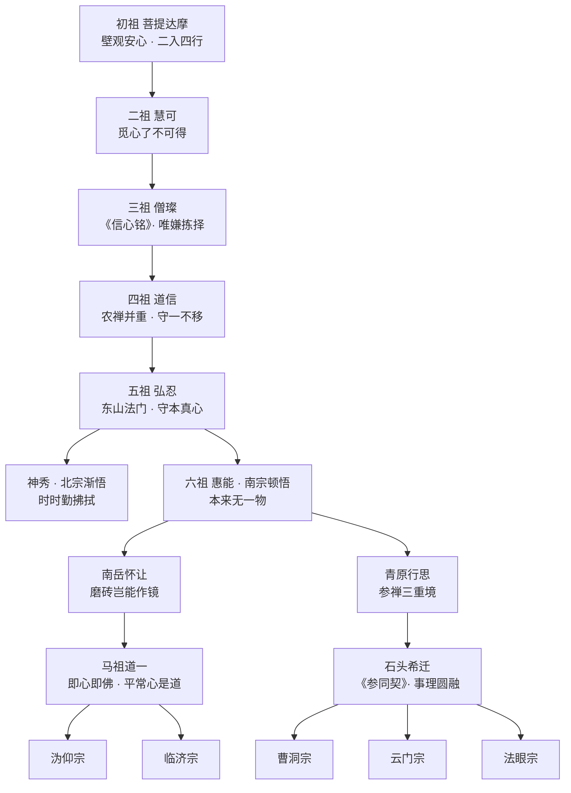

# 02 · 禅宗法脉与一花五叶

> 灵山会上，世尊拈花，迦叶微笑。  
> 从达摩西来到一花开五叶，禅宗发展出一套人类精神史上最凌厉、最活泼的觉悟教学法。

---

## 一、东土六祖传灯

---

## 二、唐代黄金时代：洪州与石头

六祖之后，禅宗由「单传」走向「大兴」，形成两大源流：

- **马祖道一（洪州宗）**：提出「即心即佛」「非心非佛」「平常心是道」。将禅彻底融入行住坐卧、扬眉瞬目，打破一切庄严刻板的修行仪轨。
- **石头希迁（石头宗）**：著《参同契》，融通本体（暗/理）与现象（明/事），沉潜绵密，开后世曹洞、云门、法眼三宗之先河。

---

## 三、一花开五叶：五家宗风对比

禅宗五家并非见地有高下，而是**接引学人的手段（家风）各有奇绝**：

| 宗派 | 开山祖师 | 核心家风 | 标志性手段 / 理论 | 气质喻象 |
| :--- | :--- | :--- | :--- | :--- |
| **临济宗** | 临济义玄 | **峻烈直截，雷霆万钧** | 棒喝交驰、四料简、三玄三要、「无位真人」 | 迅雷惊电，单刀直入 |
| **曹洞宗** | 洞山良价、曹山本寂 | **绵密细行，回互圆融** | 偏正五位（正中偏、偏中正、正中来、兼中至、兼中到）、默照禅 | 细雨润物，如临深渊 |
| **云门宗** | 云门文偃 | **孤危耸拔，一字关锋** | 云门三句（函盖乾坤、截断众流、随波逐浪）、一字禅（如「关」「干屎橛」） | 孤峰顶上，刀锋断流 |
| **沩仰宗** | 沩山灵祐、仰山慧寂 | **方圆默契，师资相投** | 圆相教学（画圆示法）、体用双彰 | 慈父严师，温润深沉 |
| **法眼宗** | 清凉文益 | **对病施药，理事不二** | 六相圆融、借教明宗、「三界唯心，万法唯识」 | 良医切脉，清净无染 |

---

## 四、宋代两大修法合流：看话禅与默照禅

宋代以后，五家之中以**临济**与**曹洞**流布最广，并凝练出两大经典实修路径，流传至今：

1. **看话禅（临济 · 大慧宗杲提倡）**
   - 取古德公案中最无理路可寻的一句（话头，如「狗子还有佛性也无？——无！」），提起大疑情，不落思惟、不作解释，逼至山穷水尽处，桶底脱落。
   - **适合**：心念散乱、理性思辨过重、需要强力破除知见壁垒之人。
2. **默照禅（曹洞 · 宏智正觉提倡）**
   - 「默默忘言，昭昭现前。」不造作、不期待、不执着于「求悟」，只在端坐澄明中，寂静（默）与清晰觉照（照）同时现前，如秋水映月，本来具足。
   - **适合**：心性沉静、容易急躁求成或执着于戏剧性开悟体验之人。

> **究竟而言**：看话禅是「从疑入默」，默照禅是「即默即照」；一破一立，殊途同归。
