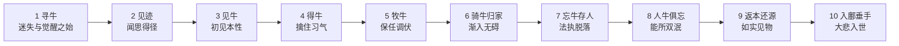

# 04 · 十牛图修证阶次

> 宋代廓庵师远禅师所作《十牛图颂》，是禅宗史上最完整、最具深度的**心理与觉悟现象学地图**。  
> 「牛」喻本心（佛性），「牧童」喻觉照之智。从迷失到究竟，一共十步，环环相扣。

---

## 全景概览

---

## 十重阶次精析

### 第一 · 寻牛（Searching for the Ox）
- **原颂**：茫茫拨草去追寻，水阔山遥路更深。力尽神疲无处觅，但闻枫树晚蝉吟。
- **心境**：感到生命隐约的匮乏与不安，隐约觉察到除了世俗追逐外另有归处，于是开始向外寻找真理。
- **盲点**：以为「道」在远方、在书本里、在大师口中，却不知自己从未真正丢失过它。

### 第二 · 见迹（Seeing the Footprints）
- **原颂**：水边林下迹偏多，芳草离披见也么？纵是深山更深处，辽天鼻孔怎藏他。
- **心境**：通过研读经典、听闻正法、静心观察，理性上终于看到了佛法的脉络与痕迹，知道修行有路可循。
- **盲点**：极易把「脚印」当成「牛本身」——沉溺于哲学概念、术语辨析，产生「我已经懂了」的傲慢。

### 第三 · 见牛（Seeing the Ox）
- **原颂**：黄莺枝上一声声，日暖风和岸柳青。只此更无回避处，森森头角画难成。
- **心境**：**初见本性（见道）**。某一刻疑情豁破，不再只是用头脑理解，而是直接经验到念头背后那个清晰无碍的觉性——六根门头，历历孤明。
- **盲点**：初尝法喜容易兴奋执着，误以为「见牛」便已大功告成。

### 第四 · 得牛（Catching the Ox）
- **原颂**：竭尽精神获得渠，心强力壮卒难除。有时才到高原上，又入烟云深处居。
- **心境**：虽然亲见本心，但累世积累的贪嗔痴习气依然强悍如野牛。遇顺逆境时，惯性立刻拉着心奔逃，必须牢牢攥紧正念的缰绳。
- **关键**：**悟后起修**的真正起点。绝不放纵习气，也不因习气反复而怀疑所见。

### 第五 · 牧牛（Taming the Ox）
- **原颂**：鞭索时时莫离身，恐伊纵步入埃尘。相将牧得纯和也，羁锁无拘自逐人。
- **心境**：在日用伦常中绵密保任。情绪起时即刻觉察，妄念生时自然照破，久而久之，心念由野性难驯转为柔和驯顺。
- **关键**：绵密而不紧绷，既不放逸，也不暴力压抑。

### 第六 · 骑牛归家（Riding the Ox Home）
- **原颂**：骑牛迤逦欲还家，羌笛声声送晚霞。一拍一歌无限意，知音何必鼓唇牙。
- **心境**：抗争已息，修行不再费力。觉照与生活逐渐融为一体，内心生出深沉的安定与轻盈，无需再刻意与念头搏斗。

### 第七 · 忘牛存人（The Ox Transcended）
- **原颂**：骑牛已得到家山，牛也空兮人也闲。红日三竿犹作梦，鞭绳空顿草堂间。
- **心境**：「修行」「佛性」「开悟」这些概念工具也终于可以放下了——既已到家，何须再牵着一头名为「悟境」的牛？但此时，仍存留一丝极微细的「我已自在、我在安住」的主体痕迹（存人）。

### 第八 · 人牛俱忘（Both Ox and Self Transcended）
- **原颂**：鞭索人牛尽属空，碧天辽阔信难通。红炉焰上争容雪？到此方能合祖宗。
- **图相**：**一个纯粹的空圆（圆相）**。
- **心境**：连最后那一丝「我是觉悟者」的微细我执也彻底消融。能觉与所觉、主体与客体、圣与凡、空与有全部脱落。如雪落红炉，片刻无痕。
- **警示**：若止步于此，易堕「耽着空寂、厌离世间」的沉空滞寂之病。所以十牛图并不止于第八。

### 第九 · 返本还源（Returning to the Source）
- **原颂**：返本还源已费功，争如直下若盲聋？庵中不见庵前物，水自茫茫花自红。
- **心境**：彻底透脱空性之后，世界非但没有消失，反而以前所未有的鲜活重新呈现——山只是山，水只是水，花自红、水自流，不再掺杂一丝自我的投射与扭曲。**真空即妙有**。

### 第十 · 入鄽垂手（Entering the Marketplace with Helping Hands）
- **原颂**：露胸跣足入廛来，抹土涂灰笑满腮。不用神仙真秘诀，直教枯木放花开。
- **心境**：觉悟的最高顶点，不是端坐莲台、远离尘嚣，而是**不带任何神圣光环地回到烟火人间**，与普通人同悲同喜、随缘利他。没有「我在度众生」的优越感，只有自然流露的慈悲与通透。
